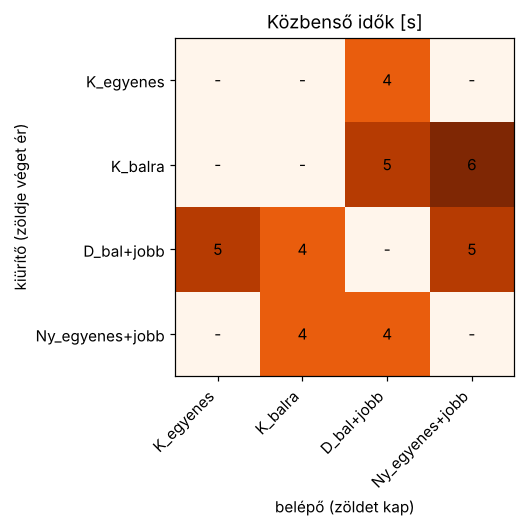
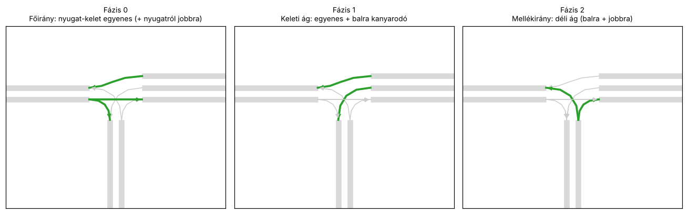

# A csomópont, a fázisok és a közbenső idők

> Röviden: **ezzel nem kell foglalkoznod.** Az ágens csak egy fázis sorszámát
> választja; a környezet gondoskodik róla, hogy a jelzőlámpák mindig szabályosan
> és biztonságosan váltsanak. Ez az oldal azért van, hogy értsd, mi történik a
> háttérben.

## A csomópont

Egyszerű T-csomópont, jobbkezes forgalommal. Minden ág 250 m hosszú, a
megengedett sebesség 50 km/h.

```
        Nyugat (W) ═══════════════╦═══════════════ Kelet (E)
                                  ║
                                  ║
                               Dél (S)
```

| Ág | Bejövő sáv | Mozgások |
|---|---|---|
| Nyugat (W) | `W_C_0` | egyenesen keletre + jobbra délre (közös sáv) |
| Kelet (E) | `E_C_0` | egyenesen nyugatra |
| Kelet (E) | `E_C_1` | balra, délre (külön kanyarodósáv) |
| Dél (S) | `S_C_0` | balra nyugatra + jobbra keletre (közös sáv) |

A keleti („jobb oldali”) bejövő ág tehát **ketté van osztva**: a balra
kanyarodók külön sávban várakoznak, így nem tartják fel az egyenesen
haladókat.

## Fogalmak

* **Jelzőcsoport**: azon mozgások halmaza, amelyek mindig ugyanazt a jelzést
  kapják. Nálunk egy bejövő sáv = egy jelzőcsoport (4 csoport).
* **Konfliktus**: két csoport konfliktusos, ha a járműveik útvonala keresztezi
  egymást vagy összefut. Konfliktusos csoportok nem kaphatnak egyszerre zöldet.
* **Fázis**: konfliktusmentes csoportok halmaza, amelyek egyszerre kapnak zöldet.
* **Közbenső idő** (intergreen) `k(i→j)`: az `i` csoport zöldjének vége és a
  vele konfliktusos `j` csoport zöldjének kezdete között minimálisan eltelő idő.
  Ennyi idő kell ahhoz, hogy az utolsó, még zölden behajtó jármű elhagyja az
  ütközési pontot, mielőtt az új irány járművei odaérnek.
* **Átmenet**: két fázis közötti jelzésképsorozat (sárga, piros, piros-sárga).

## A közbenső idők számítása

A közbenső időket a repó meglévő közbensőidő-számító kódja (`geometry_utils.py`,
`sumo_parser.py`) számolja a SUMO hálózat geometriájából:

1. minden mozgás pályáját simított görbével közelíti, és kiszámolja a
   kanyarodási sugarat, abból a sebességet,
2. megkeresi a pályák ütközési pontjait,
3. kiszámolja a kiürítési és a behaladási időt:
   `k = 3 s + (kiürítési út + 6 m) / v_kiürítő − behaladási út / v_belépő`,
   felfelé kerekítve.

A `sumo_morl.intergreen` modul ebből a mozgásszintű mátrixból jelzőcsoport-szintű
mátrixot képez (a csoport mozgásainak maximuma):



## A fázisok

A fázisokat a konfliktusmátrixból kapjuk: a konfliktusmentes csoportok maximális
halmazai (gráfelméletben: klikkek). Ebből a csomópontból pontosan három adódik:



| Fázis | Zöldet kap | Megjegyzés |
|---|---|---|
| 0 | `W_C_0` + `E_C_0` | főirány mindkét irányban egyenesen (+ nyugatról jobbra) |
| 1 | `E_C_0` + `E_C_1` | keleti ág: egyenes + védett balra kanyarodás |
| 2 | `S_C_0` | déli mellékág |

## Az átmenetek

Fázisváltáskor a környezet automatikusan lejátssza az átmenetet:

* a megszűnő csoportok 3 s **sárgát**, majd pirosat kapnak,
* az induló csoportok annyi idő után kapnak zöldet, amennyit a közbenső idő
  előír (legalább 2 s), és előtte 2 s **piros-sárgát** kapnak,
* a mindkét fázisban zöld csoportok végig zöldek maradnak.

Az átmenetek hossza (s):

| honnan \ hova | 0 | 1 | 2 |
|---|---|---|---|
| **0** | – | 4 | 4 |
| **1** | 6 | – | 5 |
| **2** | 5 | 5 | – |

Az átmenetek alatt (és utána a minimális zöldidő alatt) az ágens nem dönt; ez
a forgalomtechnikában **elveszett idő**, ezért a túl gyakori váltás rontja az
áteresztőképességet.

## Kiírás és ábrák a saját gépeden

```python
from sumo_morl import TJunctionScenario
from sumo_morl.visualize import plot_scenario, plot_phases, plot_intergreen

sc = TJunctionScenario()
print(sc.describe())                 # csoportok, közbenső idők, fázisok, átmenetek, detektorok
plot_scenario(sc).savefig("csomopont.png")
plot_phases(sc).savefig("fazisok.png")
```

A hálózat újragenerálása (pl. más ághosszal) csak haladóknak kell:
`python -m sumo_morl.network`, illetve `sumo_morl.network.build_network()`.
