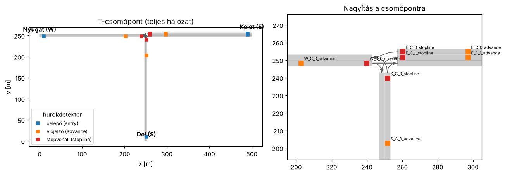

# sumo_morl – többcélú megerősítéses tanulás jelzőlámpa-vezérléshez

A `sumo_morl` egy oktatási célú Python könyvtár, amellyel **forgalomtechnikai
előismeretek nélkül** lehet többcélú megerősítéses tanulással (MORL)
jelzőlámpa-vezérlő ágenseket fejleszteni a [SUMO](https://eclipse.dev/sumo/)
forgalomszimulátorban.

Minden forgalomtechnikai rész készen van:

* egy **T-csomópont** hálózata (a keleti ág ketté van osztva balra kanyarodó és
  egyenes sávra),
* a **közbenső idők** (intergreen) a repó közbensőidő-számító kódjával készülnek, a
  csomópont geometriájából,
* a **fázisok**, és köztük a szabályos **átmenetek** (sárga, piros, piros-sárga),
* **indukcióshurok-detektorok** minden bejövő sávon,
* **forgalmi igény** generálása (epizódonként véletlen),
* klasszikus **összehasonlító vezérlők** (fix idejű, járműkövető, mohó).

A hallgató feladata „csak” az ágens: minden döntési pontban meg kell mondania,
**melyik fázis** legyen a következő.



## Tartalom

1. [Telepítés](#telepítés)
2. [Gyors kezdés](#gyors-kezdés)
3. [A csomópont, a fázisok és a közbenső idők](01_csomopont_es_jelzesterv.md)
4. [Megfigyelés: hurokdetektorok (csak mérhető adatok)](02_megfigyeles.md)
5. [Jutalomvektor: célfüggvények](03_celfuggvenyek.md)
6. [A környezet API-ja (akció, lépés, info)](04_kornyezet_api.md)
7. [MORL segédfüggvények és összehasonlító vezérlők](05_segedfuggvenyek.md)
8. [Feladatötletek hallgatóknak](06_feladatotletek.md)

## Telepítés

Python 3.9 vagy újabb kell. A repó gyökeréből:

```bash
python -m venv .venv
source .venv/bin/activate          # Windows: .venv\Scripts\activate
pip install -e .                   # a könyvtár + SUMO (eclipse-sumo pip csomag)
pip install -e ".[rl]"             # + Stable-Baselines3 (a 03-as példához)
```

A SUMO-t az `eclipse-sumo` pip csomag telepíti, így külön SUMO-telepítés nem
kell. Ha már van SUMO a gépen és a `SUMO_HOME` környezeti változó be van
állítva, azt használja a könyvtár.

Ellenőrzés:

```bash
python -m pytest            # a könyvtár tesztjei (kb. fél perc)
python examples/sumo_morl/01_ismerkedes.py
```

## Gyors kezdés

```python
import numpy as np
from sumo_morl import TJunctionMOEnv

env = TJunctionMOEnv(objectives=("queue", "fairness", "switches"), episode_length=3600)
obs, info = env.reset(seed=0)

done = False
total = np.zeros(env.reward_dim)
while not done:
    action = env.action_space.sample()       # <- ide jön az ágensed
    obs, reward, terminated, truncated, info = env.step(action)
    total += reward                          # a reward egy VEKTOR (célonként egy elem)
    done = terminated or truncated

print(dict(zip(env.objective_names, total)))
env.close()
```

* `action`: a következő fázis sorszáma (0, 1 vagy 2).
* `obs`: 55 elemű vektor [0, 1] tartományban, csak detektoradatokból és a
  vezérlő saját állapotából.
* `reward`: `numpy` vektor, a kiválasztott célfüggvények sorrendjében.
* `info`: részletes adatok (aktuális fázis, nyers detektoradatok, és –
  **csak kiértékeléshez** – SUMO-ból kiolvasott valós mutatók).

Egycélú RL könyvtárral (pl. Stable-Baselines3) a jutalmat skalarizálni kell:

```python
from stable_baselines3 import DQN
from sumo_morl import TJunctionMOEnv, LinearScalarization

env = LinearScalarization(TJunctionMOEnv(), weights=[0.6, 0.3, 0.1])
model = DQN("MlpPolicy", env).learn(50_000)
```

A grafikus felülethez add meg a `gui=True` paramétert: ekkor a `sumo-gui`
indul el, és látható, mit csinál az ágens.

## Példák

| Fájl | Mit mutat be |
|---|---|
| `examples/sumo_morl/01_ismerkedes.py` | a környezet, a jelzésterv kiírása, véletlen ágens |
| `examples/sumo_morl/02_baseline_osszehasonlitas.py` | klasszikus vezérlők azonos forgalmon, Pareto-ábra |
| `examples/sumo_morl/03_sb3_sulyozott_tanitas.py` | DQN tanítása több súlyvektorral, Pareto-front, hipertérfogat |
| `examples/sumo_morl/04_sajat_celfuggveny.py` | saját célfüggvény definiálása |

## A könyvtár felépítése

| Modul | Tartalom |
|---|---|
| `sumo_morl/env.py` | `TJunctionMOEnv` – a Gymnasium környezet |
| `sumo_morl/objectives.py` | célfüggvények (jutalomkomponensek), `register_objective` |
| `sumo_morl/detectors.py` | hurokdetektorok elhelyezése, olvasása, aggregálása |
| `sumo_morl/intergreen.py` | jelzőcsoportok, fázisok, átmenetek a közbensőidő-számításból |
| `sumo_morl/scenario.py` | a T-csomópont forgatókönyv (hálózat + jelzésterv + detektorok) |
| `sumo_morl/network.py` | a hálózat generálása `netconvert`-tel |
| `sumo_morl/traffic.py` | forgalmi igény (`Demand`) és route fájl |
| `sumo_morl/policies.py` | összehasonlító vezérlők |
| `sumo_morl/morl.py` | skalarizálás, súlyok, Pareto-front, hipertérfogat, kiértékelés |
| `sumo_morl/visualize.py` | ábrák (csomópont, fázisok, közbenső idők, epizód) |
| `sumo_morl/data/t_junction.net.xml` | a kész hálózat |

A közbenső időket a repó gyökerében lévő, már meglévő `geometry_utils.py` és
`sumo_parser.py` számolja (ugyanaz a kód, amit a GUI-s közbensőidő-számító is
használ); a `pip install -e .` ezeket is telepíti.
